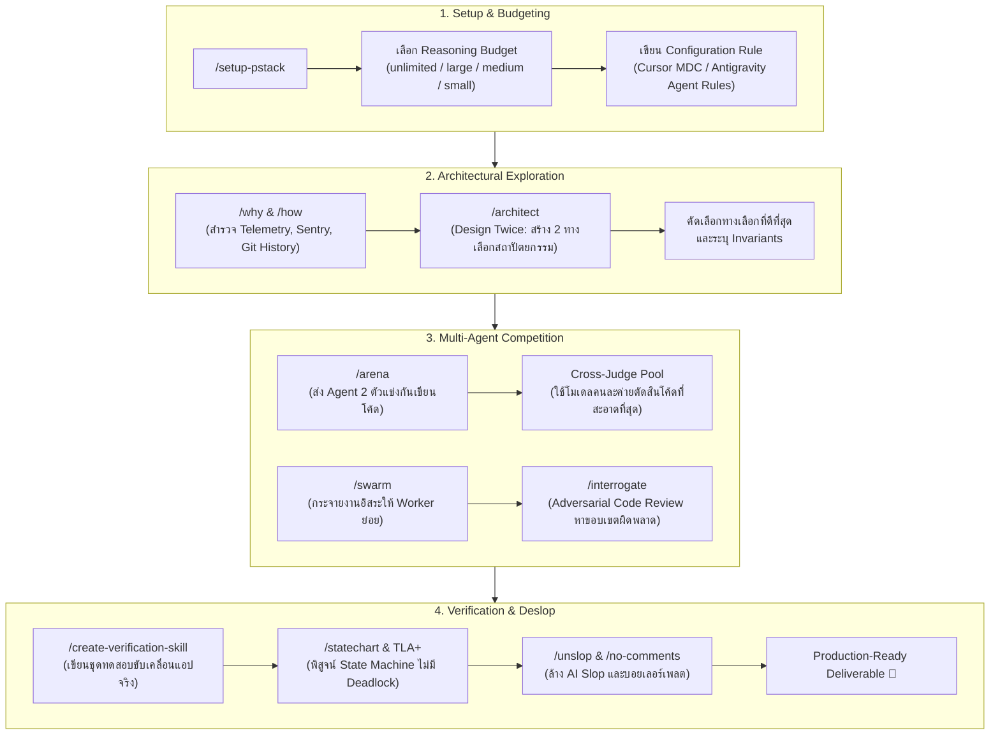

# 🛡️ PStack Production Rigor Workflow
> **Universal Engineering Rigor & Multi-Agent Verification Framework**  
> *Originated by Lauren Tan ([@poteto](https://github.com/poteto)) | Adapted for Universal AI Agents (Antigravity, Gemini, Cursor, Claude Code)*

---

## 📑 สารบัญ (Table of Contents)
1. [ภาพรวมของ PStack (Overview & Philosophy)](#1-ภาพรวมของ-pstack-overview--philosophy)
2. [สถาปัตยกรรมการแยกส่วน (Isolation Architecture)](#2-สถาปัตยกรรมการแยกส่วน-isolation-architecture)
3. [วงจรการทำงาน 4 ขั้นตอน (The 4-Phase Lifecycle Workflow)](#3-วงจรการทำงาน-4-ขั้นตอน-the-4-phase-lifecycle-workflow)
   - [Phase 1: Setup & Model Budgeting](#phase-1-setup--model-budgeting)
   - [Phase 2: Architectural Exploration & Ground Truth](#phase-2-architectural-exploration--ground-truth)
   - [Phase 3: Multi-Agent Competition & Swarm Execution](#phase-3-multi-agent-competition--swarm-execution)
   - [Phase 4: Verification, Formal Proofs & De-slop](#phase-4-verification-formal-proofs--de-slop)
4. [ตาราง Model Allocation Matrix (Universal Compatibility)](#4-ตาราง-model-allocation-matrix-universal-compatibility)
5. [คลัง 24 Engineering Principles (The 24 Principles Catalog)](#5-คลัง-24-engineering-principles-the-24-principles-catalog)
6. [คู่มือการเปิดใช้งานและสลับโหมด (How to Activate & Switch Presets)](#6-คู่มือการเปิดใช้งานและสลับโหมด-how-to-activate--switch-presets)

---

## 1. ภาพรวมของ PStack (Overview & Philosophy)

### ปัญหาของ AI Coding ทั่วไป
เมื่อ AI Agent ทำงานในโหมดปกติ มักจะทำตัวเหมือน **"Junior Developer ที่เร่งรีบ"**:
- รีบเขียนโค้ดทันทีโดยไม่สำรวจสถาปัตยกรรมอย่างลึกซึ้ง (Hasty Implementation)
- เลือกวิธีแก้ปัญหาแรกที่นึกออก โดยไม่เปรียบเทียบข้อดี-ข้อเสียของ Alternative designs
- ผลิตโค้ดที่มี AI Slop (คอมเมนต์อธิบายสิ่งที่โค้ดบอกอยู่แล้ว, บอยเลอร์เพลตเกินจำเป็น)
- ตรวจสอบความถูกต้องแค่ระดับ syntax หรือยูนิตเทสต์ตื้นๆ แต่ไม่สามารถการันตี Invariants ของระบบได้

### ปรัชญาของ PStack (Production Rigor)
**PStack** เปลี่ยน AI Agent ให้ทำงานเหมือน **"Principal Systems Engineer & Staff Architect"**:
1. **Design Twice Before Coding**: สำรวจความจริงเชิงญาณวิทยา (Epistemics) และออกแบบสถาปัตยกรรมแข่งกันอย่างน้อย 2 ทางเลือกก่อนแตะต้องโค้ดจริง
2. **Multi-Agent Competition & Cross-Judging**: ส่ง Subagents หลายตัวไปแข่งแก้ปัญหาเดียวกัน แล้วตั้ง Neutral Judge จากโมเดลค่ายอื่นมาตัดสินแบบ Blind Test
3. **Formal Verification & Statechart Invariants**: ใช้แบบจำลองคณิตศาสตร์และการตรวจสอบสถานะ (TLA+ / Statecharts) เพื่อพิสูจน์ว่าระบบจะไม่เกิด Deadlock หรือ Race Condition ในทุกกรณี
4. **Aggressive Deslop**: กำจัดขยะโค้ด (AI-slop, Redundant Comments, Bloated Interfaces) และบังคับใช้ 24 หลักการทางวิศวกรรมที่เข้มงวด

---

## 2. สถาปัตยกรรมการแยกส่วน (Isolation Architecture)

เพื่อรักษาความคลีน ไม่ให้ทั้ง 60 Skills ของ PStack เข้าไปปะปนกับคลัง 57 Skills มาตรฐานในชีวิตประจำวัน เราจึงออกแบบโครงสร้างแบบ **Strictly Isolated Subsystem**:

```
my-agent-skills/
├── skills/                     # 🌟 Curated Standard Skills (57 รายการ - โหมดปกติ)
│   ├── setup-pstack/           # 🔌 Universal Entrypoint Skill (เรียก /setup-pstack ได้เสมอ)
│   ├── grill-me/
│   ├── tdd/
│   ├── web-app-development/
│   └── ...
│
├── pstack/                     # 🛡️ PStack Isolated Ecosystem (60 Skills เฉพาะทาง)
│   ├── setup-pstack/           # Rule generator & model config
│   ├── poteto-mode/            # Full production orchestrator
│   ├── architect/              # Design twice system
│   ├── arena/                  # Multi-agent racing & cross-judge
│   ├── swarm/                  # Parallel worker fan-out
│   ├── interrogate/            # Adversarial code reviewer
│   ├── create-verification-skill/        # Behavioral test generator
│   ├── create-formal-verification-skill/ # TLA+ formal verification
│   ├── statechart/             # Statechart compiler & model checker
│   ├── unslop/                 # Code cleanliness & slop remover
│   ├── principle-*/            # 24 Fundamental Engineering Principles
│   └── ...
│
├── config/
│   └── presets.json            # กำหนด Preset "pstack-rigor"
├── skill_manager.py            # CLI สำหรับสลับเปิด-ปิดระบบ
└── PSTACK_WORKFLOW.md          # 📖 คู่มือการทำงานฉบับนี้
```

> [!NOTE]
> ในสภาวะปกติ ระบบจะใช้เพียง `skills/` ทำให้การทำงานเร็ว ไม่เปลือง Token Context Window  
> เมื่อต้องการความเข้มงวดระดับ Mission-Critical สามารถเปิด PStack ได้ทันทีผ่าน `/setup-pstack` หรือ `python skill_manager.py preset apply pstack-rigor`

---

## 3. วงจรการทำงาน 4 ขั้นตอน (The 4-Phase Lifecycle Workflow)



---

### Phase 1: Setup & Model Budgeting
ก่อนเริ่มงาน PStack จะจัดสรรงบประมาณการคิด (Reasoning Budget) และมอบหมายหน้าที่ให้โมเดลที่เหมาะสมที่สุด:

1. **เรียกคำสั่ง `/setup-pstack`**
2. **เลือกงบประมาณ (Reasoning Budget)**:
   - `unlimited — max reasoning`: ใช้การคิดขั้นสูงสุด สำหรับงานโครงสร้างพื้นฐานระดับ Core Engine
   - `large — xhigh reasoning` *(แนะนำสำหรับ Production)*: สำหรับงานฟีเจอร์หลักและการรีแฟกเตอร์ขนาดใหญ่
   - `medium — high reasoning`: สำหรับงานประจำวัน รวดเร็วและประหยัดโทเค็น
   - `small — medium reasoning`: สำหรับการทดลองต้นแบบหรือเขียนเอกสาร
3. **การเขียนกฎ Configuration**:
   - ใน Cursor: บันทึกไปยัง `~/.cursor/rules/pstack-models.mdc`
   - ใน Antigravity/Gemini: บันทึกไปยัง `.agents/rules/pstack-models.md` หรือ `~/.gemini/pstack-models.json`

---

### Phase 2: Architectural Exploration & Ground Truth
หลักการสำคัญคือ **"ห้ามเดาความจริง" (Do not guess the ground truth)**:

1. **Epistemic Investigation (`why` & `how`)**:
   - Agent จะขุดค้นประวัติโค้ด (Code Archaeology), อ่าน PR ย้อนหลัง, ตรวจสอบ Error logs (Sentry/Datadog) เพื่อเข้าใจว่าทำไมโค้ดเดิมจึงเขียนแบบนั้น
2. **Design Twice (`architect`)**:
   - แทนที่จะเสนอแผนเดียว Agent จะสร้างสถาปัตยกรรมที่แตกต่างกันอย่างสิ้นเชิง **2 รูปแบบ (Proposal A vs Proposal B)**
   - วิเคราะห์ Trade-off: Memory footprint, Latency, Extensibility, Failure modes
   - บังคับใช้หลักการ `principle-exhaust-the-design-space` และ `principle-model-the-domain`

---

### Phase 3: Multi-Agent Competition & Swarm Execution
เมื่อได้สถาปัตยกรรมที่เลือกแล้ว เข้าสู่กระบวนการแข่งขันเพื่อผลลัพธ์ที่ดีที่สุด:

1. **The Arena Race (`arena`)**:
   - ปล่อย Subagents อย่างน้อย 2 ตัว (Arm 1 และ Arm 2) ให้เขียนโค้ดแก้โจทย์เดียวกันอย่างอิสระ
2. **Cross-Judging**:
   - ตั้งกรรมการอิสระ (Neutral Cross-Judge) จากโมเดลค่ายอื่น (เช่น หาก Runner ใช้ Grok ให้ Judge ใช้ Claude Opus หรือ Gemini Pro) เพื่อป้องกันความลำเอียง (Bias)
   - กรรมการจะเปรียบเทียบ Pull Request / Diff ตามเกณฑ์: ความเรียบง่าย, ไม่มีโค้ดเกินจำเป็น, ความถูกต้องตาม Type system
3. **Parallel Swarm (`swarm`)**:
   - สำหรับงานขนาดใหญ่ที่มีชิ้นส่วนอิสระต่อกัน (เช่น Migration หลายๆ โมดูล) ระบบจะ Fan-out ให้ Worker หลายตัวทำงานพร้อมกัน
4. **Adversarial Interrogation (`interrogate`)**:
   - Agent ตรวจสอบโค้ดแบบจับผิด (Red-Teaming) เพื่อค้นหา Race conditions, Memory leaks, และ Boundary violations

---

### Phase 4: Verification, Formal Proofs & De-slop
การทดสอบไม่ใช่แค่ "Unit test ผ่าน":

1. **Behavioral App Verification (`create-verification-skill`)**:
   - สร้าง Skill เฉพาะโปรเจกต์ที่ขับเคลื่อนแอปเหมือนมนุษย์ (Headless Browser / Playwright หรือ CLI Driver) เพื่อพิสูจน์พฤติกรรมจริงจากภายนอก
2. **Formal Verification & Statecharts (`create-formal-verification-skill`, `statechart`)**:
   - แปลงตรรกะสถานะ (State Logic) ออกมาเป็น Statechart และรันการตรวจสอบทางคณิตศาสตร์ (TLA+ Model Checker) พิสูจน์ว่าไม่มี Deadlock ในทุกสภาวะที่เป็นไปได้
3. **De-slop Protocol (`unslop`, `no-comments`)**:
   - สแกนและลบคอมเมนต์ที่ไม่จำเป็น (`// function that calculates total`)
   - ลบ Wrapper ซ้ำซ้อน, ลบ Helper ที่ใช้ครั้งเดียว, และลบ Abstraction ที่เพิ่มความซับซ้อนโดยไม่จำเป็น
   - ตรวจสอบ `blast-radius` เพื่อให้แน่ใจว่าการแก้ไขกระทบเฉพาะจุดที่ต้องการเท่านั้น

---

## 4. ตาราง Model Allocation Matrix (Universal Compatibility)

| บทบาทใน PStack (Role) | Antigravity Tier (มี Pro) | Antigravity Tier (ไม่มี Pro / แนะนำ) | Cursor Slug (Large Budget) | หน้าที่ความรับผิดชอบ |
|---|---|---|---|---|
| **Judgment & Prose** | `pro` | **`inherit`** *(Parent Model)* | `claude-opus-5-5-xhigh` | ประเมินภาพรวม สังเคราะห์ข้อความ และตัดสินใจระดับสถาปัตยกรรม |
| **Hardest Tasks** | `pro` | **`inherit`** *(Parent Model)* | `claude-opus-5-5-xhigh` | แก้ปัญหาอัลกอริทึมซับซ้อน หรือโจทย์ที่ต้องการการใช้เหตุผลระดับลึก |
| **Architect Runners** | `pro` (Multi-arm) | **`inherit`** *(Parent Model)* | `claude-opus-5-5-xhigh` / `grok-4.7-xhigh-fast` | คิดและออกแบบสถาปัตยกรรม 2 รูปแบบที่แข่งขันกัน |
| **Arena Cross-Judge** | `pro` (Independent) | **`inherit`** *(Parent Model)* | `claude-opus-5-5-xhigh` | กรรมการคนกลางตัดสินการแข่งขันของ Agent อย่างเป็นกลาง |
| **How Explainer** | `pro` | **`inherit`** *(Parent Model)* | `claude-opus-5-5-xhigh` | อธิบายกลไกการทำงานของระบบอย่างเข้าใจง่ายและลึกซึ้ง |
| **Why Synthesizer** | `pro` | **`inherit`** *(Parent Model)* | `claude-opus-5-5-xhigh` | สรุปผลการขุดค้นประวัติศาสตร์ของระบบและสาเหตุรากเหง้า |
| **Feature & Refactoring**| `flash` | `flash` (หรือ `inherit`) | `grok-4.7-xhigh-fast` | เขียนโค้ดฟีเจอร์และปรับแต่งโค้ดด้วยความเร็วสูง |
| **Bug-Fix & Perf-Issue** | `flash` | `flash` (หรือ `inherit`) | `grok-4.7-xhigh-fast` | ไล่แก้จุดบกพร่องเฉพาะจุดและการเพิ่มประสิทธิภาพ |
| **Swarm Workers** | `flash` (Fan-out) | `flash` (Fan-out) | `grok-4.7-xhigh-fast` | คนงานย่อยที่รับงานคู่ขนานไปประมวลผล |
| **How Explorer** | `flash` | `flash` | `grok-4.7-xhigh-fast` | สำรวจไฟล์และโครงสร้าง Codebase รวดเร็ว |
| **Why Investigators** | `flash` | `flash` | `grok-4.7-xhigh-fast` | ค้นหาหลักฐานจากบันทึกและระบบติดตามเหตุการณ์ |
| **Reflect Tooling** | `flash` | `flash` | `grok-4.7-xhigh-fast` | รัน linter, tests, syntax checker |

> [!IMPORTANT]
> **กรณีที่ Antigravity ไม่มีโมเดล `pro` หรือติดข้อจำกัด Quota:**
> 1. **เปลี่ยนบทบาทที่ใช้สมองคิดระดับลึกให้เป็น `inherit`**:  
>    เมื่อตั้งค่าเป็น `inherit` ตัว Subagent จะสืบทอดโมเดลหลักที่กำลังรันอยู่ในห้องแชตปัจจุบัน (Parent Chat Model) เช่น หากคุณเลือกโมเดลหลักเป็น Claude 3.7 Sonnet หรือโมเดลตัวท็อปใน Antigravity UI ตัว Subagent ก็จะทำงานด้วยโมเดลนั้นทันทีโดยอัตโนมัติ
> 2. **บทบาทคนงานย่อย (Swarm / Explorers / Tooling)**:  
>    ยังคงใช้ `flash` เพื่อการประมวลผลที่รวดเร็วและประหยัดเวลา หรือจะใช้ `inherit` ทั้งหมด (All-Inherit Mode) ก็ได้เช่นกัน

---

## 5. คลัง 24 Engineering Principles (The 24 Principles Catalog)

PStack ได้รวบรวม 24 กฎเหล็กทางวิศวกรรม (`pstack/principle-*`) ที่ Agent จะต้องยึดถือในการเขียนโค้ด:

| # | ชื่อ Principle | สรุปหัวใจสำคัญ |
|---|---|---|
| 1 | `principle-attack-the-premise` | ตั้งคำถามกับสมมติฐานเดิมก่อนเริ่มแก้ปัญหา หากโจทย์ตั้งมาผิด ให้แก้ที่โจทย์ |
| 2 | `principle-boundary-discipline` | กำหนดขอบเขตของโมดูลให้ชัดเจน ข้อมูลไม่ควรข้ามขอบเขตโดยไม่ผ่านอินเทอร์เฟซ |
| 3 | `principle-build-the-lever` | ลงทุนสร้างเครื่องมือและสคริปต์อัตโนมัติก่อน เพื่อผ่อนแรงงานที่ต้องทำซ้ำ |
| 4 | `principle-encode-lessons-in-structure` | นำบทเรียนจาก Bug ในอดีตมาแปลงเป็น Type, Lint Rule หรือ Test เพื่อป้องกันไม่ให้เกิดซ้ำตลอดกาล |
| 5 | `principle-exhaust-the-design-space` | สำรวจทุกความเป็นไปได้ในการออกแบบ อย่าหยุดที่ไอเดียแรกที่คิดได้ |
| 6 | `principle-experience-first` | เริ่มต้นจากประสบการณ์ของผู้ใช้หรือผู้เรียกใช้ API (DX/UX First) ก่อนลงมือเขียนไส้ใน |
| 7 | `principle-explain-the-number` | ตัวเลขทุกตัวในโค้ด (Timeout, Batch size, Cache TTL) ต้องมีคำอธิบายเหตุผลและที่มา |
| 8 | `principle-fix-root-causes` | แก้ไขที่ต้นตอของปัญหา ไม่ใช่แค่เอา `if (x == null)` มาครอบเพื่อปิด Error |
| 9 | `principle-foundational-thinking` | คิดจากหลักการพื้นฐานทางคอมพิวเตอร์ (I/O, Cache, Latency, Data layout) |
| 10 | `principle-guard-the-context-window` | อย่าดึงไฟล์หรือข้อมูลที่ไม่เกี่ยวข้องเข้าสู่ Context Window ให้รักษาความสะอาดของหน่วยความจำ |
| 11 | `principle-laziness-protocol` | หลีกเลี่ยงการคำนวณหรือโหลดข้อมูลล่วงหน้าหากยังไม่มีการเรียกใช้จริง (Lazy evaluation) |
| 12 | `principle-make-operations-idempotent` | ปฏิบัติการทุกอย่างต้องปลอดภัยเมื่อถูกเรียกซ้ำ (Idempotency) |
| 13 | `principle-migrate-callers-then-delete-legacy-apis` | ทยอยย้ายผู้เรียกใช้ API เก่าให้ครบถ้วน จากนั้นลบ Legacy API ทิ้งทันที อย่าเก็บไว้เป็นหนี้สินทางเทคนิค |
| 14 | `principle-minimize-reader-load` | เขียนโค้ดให้อ่านเข้าใจง่ายที่สุด เพื่อลดภาระการทำความเข้าใจของคนอ่านโค้ด |
| 15 | `principle-model-the-domain` | ออกแบบ Type และ Data structure ให้สะท้อนความเป็นจริงของ Domain Logic อย่างตรงไปตรงมา |
| 16 | `principle-never-block-on-the-human` | ออกแบบกระบวนการให้ Agent ทำงานคู่ขนานต่อไปได้โดยไม่ต้องหยุดรอคำตอบจากมนุษย์ในจุดที่ไม่จำเป็น |
| 17 | `principle-outcome-oriented-execution` | โฟกัสที่ผลลัพธ์สุดท้ายที่ใช้งานได้จริง ไม่ใช่แค่ขั้นตอนหรือกระบวนการ |
| 18 | `principle-prove-it-works` | การเขียนเสร็จไม่ได้แปลว่าเสร็จ ต้องมีหลักฐานเชิงประจักษ์ (Log, Test, Proof) ยืนยันเสมอ |
| 19 | `principle-redesign-from-first-principles` | เมื่อระบบมีความซับซ้อนสะสมจนแก้ไม่ไหว ให้รื้อและออกแบบใหม่จาก First Principles |
| 20 | `principle-separate-before-serializing-shared-state` | แยกสถานะที่ใช้ร่วมกันออกจากกันก่อนจะจัดการกับ Concurrent access |
| 21 | `principle-sequence-verifiable-units` | ซอยงานออกเป็นหน่วยย่อยๆ ที่สามารถตรวจสอบความถูกต้องได้ทีละขั้นตอน |
| 22 | `principle-subtract-before-you-add` | พยายามลบโค้ดที่ไม่จำเป็นออกก่อนที่จะเพิ่มฟีเจอร์ใหม่เสมอ |
| 23 | `principle-test-behavior-not-implementation` | เขียน Test เพื่อทดสอบพฤติกรรมภายนอก ไม่ใช่ทดสอบรายละเอียดการทำงานภายในที่อาจถูกรีแฟกเตอร์ |
| 24 | `principle-type-system-discipline` | ใช้ประโยชน์จาก Type System อย่างเคร่งครัด ห้ามใช้ `any` หรือหลบเลี่ยงการตรวจสอบ Type |

---

## 6. คู่มือการเปิดใช้งานและสลับโหมด (How to Activate & Switch Presets)

### วิธีการเปิดใช้งาน PStack
หากคุณต้องการเปิดระบบ PStack เต็มรูปแบบในโปรเจกต์ของคุณ:

```bash
# 1. ตรวจสอบ Preset ปัจจุบัน
python skill_manager.py preset current

# 2. เปิดใช้งาน pstack-rigor preset (จะเปิดใช้งานทั้ง 60 pstack skills ทันที)
python skill_manager.py preset apply pstack-rigor

# 3. กำหนดค่างบประมาณของโมเดล
# ใน Chat ให้พิมพ์: /setup-pstack
```

### วิธีสลับกลับสู่โหมดปกติ (Lightweight Mode)
เมื่อทำงานระดับ Rigor เสร็จสิ้น และต้องการสลับกลับสู่โหมดทำงานทั่วไปที่กิน Context น้อย:

```bash
# สลับกลับเป็น Full Core (มาตรฐาน 57 skills)
python skill_manager.py preset apply full

# หรือโหมดประหยัดสุดขีด (Minimal Core)
python skill_manager.py preset apply minimal
```

---

## สรุป
ระบบ **PStack Production Rigor** ในคลัง `my-agent-skills` ได้รับการติดตั้งแบบ **Isolated Environment** อย่างสมบูรณ์แบบ คุณสามารถเรียกใช้ `/setup-pstack` ได้จากทุก Agent Session พร้อมเอกสารแนวทางปฏิบัติทางวิศวกรรมระดับโลก!
