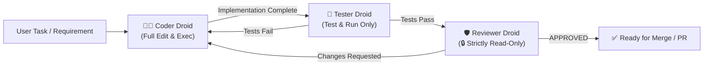

# Factory Droids: Autonomous Subagent Pipeline (Dark Factory)

Orchestrate the autonomous multi-agent pipeline inspired by Factory AI and Anthropic Claude. Automatically divides software engineering into three isolated roles with strict tool gating to eliminate bias, maximize test coverage, and catch security regressions before merge.

## When to Use This Skill
- Slash command: `/factory-droids`
- User requests: "Run autonomous pipeline for: <task>", "ให้ Droids ช่วยทำฟีเจอร์นี้", "สร้างและรัน Coder, Tester, Reviewer Droids"
- Any non-trivial feature development or refactoring requiring rigorous test verification and independent code audit.

---

## 👥 The Droid Trio (Subagents with Tool Gating)

1. **Coder Droid (`coder-droid`)**:
   - **Role**: Senior Software Engineer
   - **Permissions**: Full Read/Write/Exec (`enable_write_tools: true`)
   - **Responsibility**: Plans file architecture, implements business logic, and prepares code for verification.

2. **Tester Droid (`tester-droid`)**:
   - **Role**: QA & Automation Engineer
   - **Permissions**: Read/Write/Exec (`enable_write_tools: true`)
   - **Responsibility**: Writes unit/integration tests and executes the test runner. If tests fail, provides actionable failure traces back to Coder Droid.

3. **Reviewer Droid (`reviewer-droid`)**:
   - **Role**: Staff Engineer & Security Auditor
   - **Permissions**: **STRICTLY READ-ONLY** (`enable_write_tools: false`)
   - **Responsibility**: Inspects code diffs for architectural purity, OWASP security vulnerabilities, and spec compliance. Issues final verdict: `[APPROVED]`, `[CHANGES_REQUESTED]`, or `[SECURITY_RISK]`.

---

## 🛠️ Instructions for the Agent

When the user asks to run the autonomous pipeline for a task:

1. **Define Subagents (if not already defined)**:
   Use `define_subagent` to define `coder-droid`, `tester-droid`, and `reviewer-droid` with their respective system prompts and tool gating permissions (`enable_write_tools: true` for coder and tester, `false` for reviewer).

2. **Execute Dark Factory Loop**:
   - **Phase 1 (Code)**: Invoke `coder-droid` to write the solution and report modified files.
   - **Phase 2 (Test)**: Invoke `tester-droid` to write tests, run the test runner, and report pass/fail. If failed, send message back to coder-droid to fix.
   - **Phase 3 (Review)**: Invoke `reviewer-droid` to review the diff. If changes requested, loop back to coder-droid.

3. **Final Delivery**:
   Once Reviewer Droid approves (`[APPROVED]`), present the final report, pass rate, and summary to the user.
